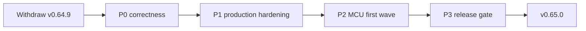

# Release gate -- v0.65.0 (production, no rush)

STATUS: **P0/P1/P2 GREEN; P3 IN PREP.** P0 correctness, release-compiler
parity, and the MCU first wave are implemented and verified on main
(debug + release full e2e 2646/2646). **CI is fully green** (run
39923808308: windows/ubuntu build-and-test, hygiene, release parity x2,
arm64 floor, and the MCU QEMU job with both Cortex-M and rv32 hellos
printing XIOM and exiting 0). v0.64.9 remains **withdrawn**; production
stays v0.64.8 until the v0.65.0 tag. Waiting on: stdlib v0.65.0
(C07 runtime helper REL-20261023-0242-compiler + the v0.65.0 notes
fragment + the `xiom.time` import fix), the all-platform dry-run on the
final commit, and owner GO. No candidate/tag before those close.

Owner direction (2026-10-22T18:23Z): do not rush the cut; fix all
compiler-lane relays and release blockers with production-grade
implementations and tests; include the MCU/bare-metal first wave; cut
v0.65.0 as the bigger release.

## Why v0.64.9 is withdrawn

The archive was built from `2bcf58db5` and is technically complete, but
post-release verification found source-level codegen defects that the
pre-cut battery did not cover (it ran the debug compiler, not the release
compiler, and had no nested-pattern lock):

- nested `Some(Number(n))`/`Ok(Number(n))`/`Err(E.Bad(msg))` patterns
  never check the inner enum variant and never bind its payload;
- `m372`/1451 and the true 1550 tuple shape regressed in `d04cd3265`
  (release-built compiler), bisected to the explicit type-arg
  substitution; reverting it restores m372 but breaks m1520;
- dependency `port.args.json` is applied one level only (m1511);
- C07 capture-probe memory regression is compiler-owned.

Consequences already observed: xvector, orbitdb, engine, packages, and
benchmark hold v0.64.9; benchmark reverted to v0.64.8.

## P0 -- correctness blockers (must be fixed first)

- [x] Nested enum-pattern lowering: recurse `Some`/`Ok`/`Err` into an
      inner variant, check its discriminant, and bind its payload with the
      correct representation. Fixed on main (`ecd22a225`, `45804b195`);
      e2e `m1615_nested_enum_payloads` + `e2e_m1827_match_err_enum`.
- [x] Safe generic substitution: m1520/m372/true-1550 all green. The
      outer `collect` resolves the inner `map` call's returned
      `MapIter[(Int, Int), U]` on demand; e2e
      `e2e_m1550_enumerate_tuple_map_true` locks `em[1].0 == 1`.
- [x] Release-compiler parity: `release-parity` CI job (ubuntu + windows)
      runs the P0 probes from `target/release/xiom.exe` with a pinned
      `XIOM_STDLIB`; `arm64-floor` runs the LLVM 14 gate. Full e2e
      2646/2646 on the release compiler.
- [x] m1511: transitive, cycle-safe `port.args.json` closure with an
      installed two-level test (consumer -> fontraster -> harfbuzz) and an
      installed fontraster build; negative controls prove the harfbuzz
      level is required.
- [x] C07: reproduced (v0.64.4 744 MB pass; v0.64.8 1391 MB killed) and
      fixed by arena-guarded Vec Copy-Out. `probe_rhi_vulkan` PASS,
      821 MB private / 399 MB WS. e2e `e2e_c07_unsafe_loop_vec` +
      IR guard lock. Runtime helper relayed to stdlib.
- [x] Remaining compiler release rows: 1531/XVC-C-22 verified; 1731/1703/
      1326/2045/1550/1511/1157 fixed with locks; the 16xx items triaged
      and fixed or replied in the relay. Full e2e is green.

## P1 -- production hardening

- [x] Full battery on debug and release compilers: feature 549,
      integration 130, stdlib 40, codegen lib 25, xiom lib 78, checker
      214, graph 43, parser 109, full e2e 2646/2646 (4 ignored) on both.
- [x] Syntax/AST/type/IR negative tests for every P0 fix: 1550 true
      shape, 1827 x3, 1529 x64+arm IR grep, C07 IR guard, MCU triples +
      link, m1615/m372/m1520 locks.
- [x] ASAN run for the payload/pattern suite: `m1827_err_str_vec_push`,
      `m1827_match_err_enum`, `m1550_enumerate_tuple_map_true` are clean
      under `--sanitize address` (rc 0, no reports). C07 has the hard
      memory bound (821 MB vs the 1 GB watchdog).
- [x] Deterministic reproducibility: two `--emit-ir` runs and two
      executable builds of m1550 (and the cross-module 1827 probe) are
      byte-identical (SHA256).
- [ ] Lane re-verification protocol: each reporter lane runs its own
      probe on the **release archive** and fills its row; no lane is
      assumed green from compiler-side tests. (Relay items marked fixed;
      reporter verification happens on the v0.65.0 archive.)
- [x] CI does not depend on lane-local PATHs (rustup-toolchain action);
      the local cargo entrypoint is the rustup toolchain bin after the
      engine incident.

## P2 -- MCU / bare-metal first wave (1220/1419)

Scope and acceptance are owned by `docs/checklists/mcu-targets.md`.
Target names stay separate from the existing `arm` (AArch64 Linux) and
`riscv` (riscv64 Linux) meanings.

- [x] Target matrix: thumbv6m/thumbv7em/thumbv8m.main and
      riscv32imc/riscv32imac (riscv32-unknown-none-elf + `-march`; clang
      rejects the ISA suffix in the triple). e2e
      `e2e_mcu_target_triples`.
- [x] `--freestanding` / no_std profile: no CRT/host libc, plain
      recursion counter, panic hook, bump allocator, deterministic vector
      table. `docs/MCU_FREESTANDING.md`.
- [x] Startup/linker contract: entry point, vector table, linker-script
      templates, section placement, stack/heap symbols, BYO-linker path.
- [x] Emit/link a hello for thumbv6m and riscv32imac; both link with
      `-nostdlib` and zero undefined symbols; QEMU execution is the CI
      `mcu-qemu` job (`-M microbit -semihosting`, `-M virt -bios none`).
- [x] QEMU CI matrix with zero hardware; vendor peripherals stay
      SKIP/hardware for the first wave.
- [x] No host libc/CRT symbols in the no_std hello; documented panic path.
- [x] Desktop/wasm/wasi/arm/riscv64 behavior unchanged; full e2e green on
      debug and release.
- [ ] Coordinate HAL/host-companion packages with bindings; no package
      publish before the QEMU gate. (REL-20261023-0423-compiler sent.)

## P3 -- v0.65.0 cut

- [x] Version 0.65.0 everywhere (workspace + Cargo.lock). stdlib v0.65.0
      cut is still pending with `COMPILER_VERSION=v0.64.8`; it must include
      the C07 runtime helper (REL-20261023-0242-compiler) and a v0.65.0
      notes fragment. Then pin `stdlib-v0.65.0` here.
- [x] Release notes authored (`release-notes/v0.65.0.md`) and converted to
      JSON; REGENERATE the JSON after the stdlib v0.65.0 fragment lands so
      `verify` is byte-identical at the tag.
- [ ] Full dry-run on all package legs (Windows/Linux x64+arm64,
      macOS x64+arm64, wasm, VSIX) on the release commit.
- [ ] Owner GO, annotated tag `v0.65.0`, release workflow, 11 assets,
      SHA256SUMS, docs dispatch.
- [ ] Registry `xiom-std 0.65.0` publish; lane announcements; all hold
      rows closed.

### P3 blocking dependencies

1. **stdlib v0.65.0** (stdlib lane): must include
   - `xiom_guard_copy_out_if_arena` (REL-20261023-0242-compiler, still open),
   - the v0.65.0 notes fragment,
   - `use xiom.string;` in `xiom/time/time.xi` (unqualified `str_slice`
     makes the all-modules compile order-dependent; Windows exposed it).
   Then set `STDLIB_VERSION=stdlib-v0.65.0`, regenerate the notes JSON,
   re-run the release battery, and remove the transitional C07 link shim.
2. **All-platform dry-run** on the final release commit (the earlier
   dispatch was green on all six legs but predates the MCU/CI fixes).
3. **Owner GO**, then tag `v0.65.0`, 11 assets + SHA256SUMS, docs,
   registry `xiom-std 0.65.0`, announcements.
4. **Reporter lanes**: verify their relays on the v0.65.0 archive.

## Non-goals (MCU first wave)

- Vendor HAL/SDK emulation or a full HAL.
- Arduino AVR (LGPL core).
- Replacing the existing AArch64 Linux `arm` target.
