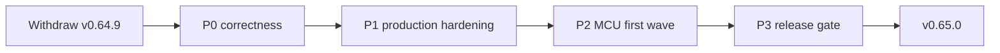

# Release gate -- v0.65.0 (production, no rush)

STATUS: **PLANNING / IN DEVELOPMENT.** v0.64.9 is **withdrawn from
adoption** (GitHub pre-release; production remains v0.64.8). The next
production cut is v0.65.0. No candidate, tag, or re-cut until the P0 and
MCU gates below are green and the owner gives GO.

Owner direction (2026-10-22T18:23Z): do not rush the cut; fix all
compiler-lane relays and release blockers with production-grade
implementations and tests; include the MCU/bare-metal first wave; cut
v0.65.0 as the bigger release.

## Why v0.64.9 is withdrawn

The archive was built from `2bcf58db5` and is technically complete, but
post-release verification found source-level codegen defects that the
pre-cut battery did not cover (it ran the debug compiler, not the release
compiler, and had no nested-pattern lock):

- nested `Some(Number(n))`/`Ok(Number(n))`/`Err(E.Bad(msg))` patterns
  never check the inner enum variant and never bind its payload;
- `m372`/1451 and the true 1550 tuple shape regressed in `d04cd3265`
  (release-built compiler), bisected to the explicit type-arg
  substitution; reverting it restores m372 but breaks m1520;
- dependency `port.args.json` is applied one level only (m1511);
- C07 capture-probe memory regression is compiler-owned.

Consequences already observed: xvector, orbitdb, engine, packages, and
benchmark hold v0.64.9; benchmark reverted to v0.64.8.

## P0 -- correctness blockers (must be fixed first)

- [ ] Nested enum-pattern lowering: recurse `Some`/`Ok`/`Err` into an
      inner variant, check its discriminant, and bind its payload with the
      correct representation (Str/Float64/Vec/struct/boxed aggregate).
      Locks: local `Option[Inner]`/`Result[Inner, Str]` Float64 and Str
      fixtures, the JSON `Number` probe, `Err(E.Bad(...))` in
      `Vec[Result[Str, E]]`, and m1243/1615/1645.
- [ ] Safe generic substitution: keep m1520 (`_max_via[U]`) and 1550 green
      while restoring m372. Add a guard so only a bare generic-param
      ident is substituted, never a concrete type argument. Locks:
      `m1520_adapter_collision`, `m1550_enumerate_tuple_map`,
      `m372_nested_generic_ptr_read`, plus the true `em[1].0` shape.
- [ ] Release-compiler parity: run the full battery with a
      **release-built** `target/release/xiom.exe`, not only the debug
      binary. Add a CI job that builds the compiler release profile and
      runs the P0 probes. This is the gate v0.64.9 missed.
- [ ] m1511: transitive dependency `port.args.json` closure (visited set,
      cycle-safe), with a two-level installed-layout test
      (consumer -> fontraster -> harfbuzz) and an installed fontraster
      build.
- [ ] C07: identify and fix the v0.64.9 capture-probe memory regression
      (v0.64.4 passes); add a memory-bound e2e with a hard RSS ceiling.
- [ ] Close/verify the remaining compiler release rows: 1531 (cleared),
      XVC-C-22 (cleared), 1731/1703/1326/2045/1550/1511, and the
      outstanding 16xx items; either fix or explicitly waive with owner
      approval.

## P1 -- production hardening

- [ ] Full battery on debug and release compilers: feature, integration,
      stdlib, codegen lib, xiom lib, graph, checker, parser, e2e suite.
- [ ] Syntax/AST/type/IR negative tests for every P0 fix.
- [ ] ASAN/UBSAN or guard-heap run for the payload/pattern suite; no
      silent memory growth in C07.
- [ ] Deterministic reproducibility check: same source + flags + stdlib
      pin produce byte-identical IR/object where applicable.
- [ ] Lane re-verification protocol: each reporter lane runs its own
      probe on the **release archive** and fills its row; no lane is
      assumed green from compiler-side tests.
- [ ] Restore the host `cargo` shims (engine incident deleted
      `C:\Users\lefte\.cargo`); CI must not depend on lane-local PATHs.

## P2 -- MCU / bare-metal first wave (1220/1419)

Scope and acceptance are owned by `docs/checklists/mcu-targets.md`.
Target names stay separate from the existing `arm` (AArch64 Linux) and
`riscv` (riscv64 Linux) meanings.

- [ ] Target matrix: `thumbv6m-none-eabi`, `thumbv7em-none-eabi`,
      `thumbv8m.main-none-eabi` (if cheap), `riscv32imc-unknown-none-elf`,
      `riscv32imac-unknown-none-elf`; triple mapping + IR/link consistency.
- [ ] `--freestanding` / no_std profile: no CRT/host libc, core-only
      stdlib surface, panic-handler hook, allocator-policy hook,
      deterministic interrupt-vector story.
- [ ] Startup/linker contract: entry point, vector table, linker-script
      template, section placement, stack/heap symbols, BYO-linker path.
- [ ] Emit/link a hello for one Cortex-M and one riscv32 target; run under
      QEMU (`microbit`/`STM32VLDISCOVERY`/`netduino` + a riscv32 machine).
- [ ] QEMU CI matrix with zero hardware; vendor peripherals stay
      SKIP/hardware for the first wave.
- [ ] No host libc/CRT symbols in the no_std hello; documented panic path.
- [ ] Desktop/wasm/wasi/arm/riscv64 behavior unchanged; existing
      target-triple tests stay green.
- [ ] Coordinate HAL/host-companion packages with bindings; no package
      publish before the QEMU gate.

## P3 -- v0.65.0 cut

- [ ] Version 0.65.0 everywhere (workspace, Cargo.lock, selfhost, VSIX
      README); stdlib v0.65.0 cut first with `COMPILER_VERSION=v0.64.8`,
      then pin `stdlib-v0.65.0` here.
- [ ] Release notes: larger release, MCU first wave, all fixed blockers,
      known issues; merged stdlib fragment; schema-valid.
- [ ] Full dry-run on all package legs (Windows/Linux x64+arm64,
      macOS x64+arm64, wasm, VSIX) on the release commit.
- [ ] Owner GO, annotated tag `v0.65.0`, release workflow, 11 assets,
      SHA256SUMS, docs dispatch.
- [ ] Registry `xiom-std 0.65.0` publish; lane announcements; all hold
      rows closed.

## Non-goals (MCU first wave)

- Vendor HAL/SDK emulation or a full HAL.
- Arduino AVR (LGPL core).
- Replacing the existing AArch64 Linux `arm` target.
